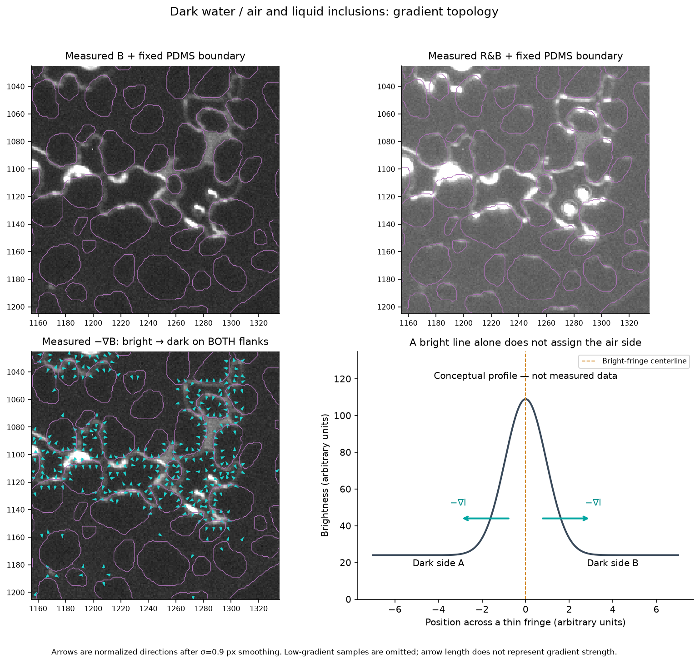

# Liquid-air phase analysis

A local Python/Spyder workflow for microscopy images of a porous bed. It combines a fixed PDMS grain reference, blue-only fluorescence and alternating red-plus-blue interface images to propose liquid/air distributions. Liquid includes both fluorescent and dark diluted water.

## View the illustrated example

**[Read the example guide on GitHub](example_batch_results/run_20261029_124806_581510/pairs/pair_000000_B6545_RB6544/METHOD_GUIDE.md)** - measured B/R&B comparisons, grain boundaries, wall profiles, gradients, phase maps and review flags.

**[Open the complete HTML report](example_batch_results/run_20261029_124806_581510/pairs/pair_000000_B6545_RB6544/GUIDE.html)** after downloading and extracting the repository. GitHub shows HTML source in the repository; open this file in a browser locally to see the formatted report. Its ten figures are included in the adjacent `figures/` folder.

The [browser entry point](GUIDE.html) and [full method guide](METHOD_GUIDE.md) also remain available. [Example saturation CSV](example_batch_results/run_20261029_124806_581510/saturation.csv).

## Run in Spyder

1. Download the repository ZIP and extract the entire folder.
2. Follow [Anaconda and Spyder installation instructions](Anaconda_Spyder_Installation_Instructions.txt), or install `requirements.txt` in the environment used by the Spyder kernel.
3. Open `settings.py`. The bundled example is ready: separate grain-reference image 0001, R&B frame 6544 and B frame 6545.
4. Open `RUN_ANALYSIS.py` in Spyder and press **F5**. Each fresh run writes a timestamped folder under `results/`.

For one pair, set `run_mode="single"` and name `blue_image` / `red_blue_image`. For a series, manually choose the B parity and inclusive start/end indices. A separate grain mask can be generated from a raw image or loaded from an already binary image.

- [Quick start](START_HERE.md)
- [Batch settings, saturation and resume](BATCH_GUIDE.md)
- [Detailed optical method](METHOD_GUIDE.md)
- [Checks and limitations](TESTED_RUN.md)

## Data and outputs

The three original 8-bit demo TIFFs are included, approximately 11.7 MiB each. Paths in `settings.py` resolve from this folder. For another acquisition, update the input paths, field geometry and acquisition-dependent thresholds.

`example_batch_results/` is a **sanitized static archive**: measured images, phase results, figures and source-image content hashes are retained, while computer-specific paths and original resume markers are removed. See [the archive note](example_batch_results/run_20261029_124806_581510/ARCHIVED_EXAMPLE.md). Run the supplied demo to produce a fresh result with valid resume metadata. Future `results/`, local acquisitions placed in `local_data/`, and Python caches are ignored by Git.

Saturation means **2D liquid/air pixel area divided by analysed pore area**. It is not a measured 3D volume fraction. Nominal labels include review-flagged proposals; inspect the review map and range with the saturation values. The workflow has been checked on one acquired pair and synthetic software tests, not independently validated on a long acquired series.

## Upload this folder

Use this folder's **contents** as the repository root: `README.md`, `settings.py`, `RUN_ANALYSIS.py`, `phase_analysis/`, `input_images/`, the guides and curated example. Include `.gitignore` and `.gitattributes`. You can upload the extracted files through GitHub's **Add file > Upload files**, or use GitHub Desktop. Do not upload the distribution ZIP as the source tree.

Every included file is smaller than GitHub's 25 MiB browser-upload limit. The original Spyder distribution is separate and unchanged.

## License

No code or data reuse license has been selected for this copy. The repository owner can add a `LICENSE` file when the intended terms are decided.
