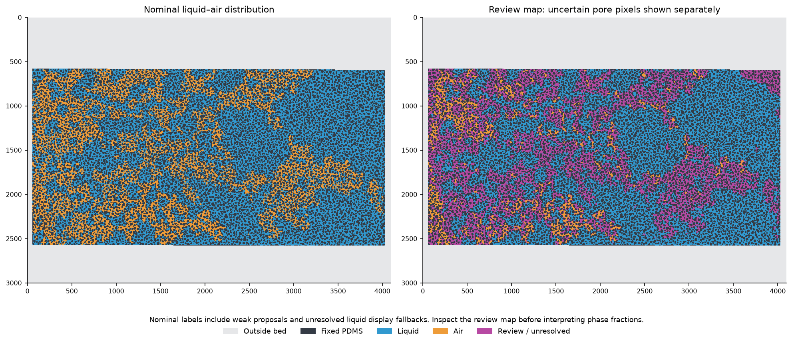
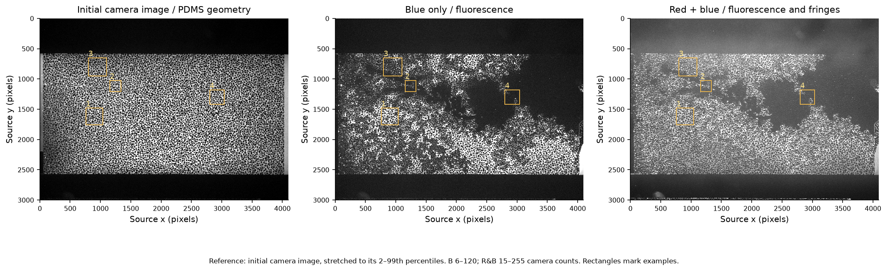
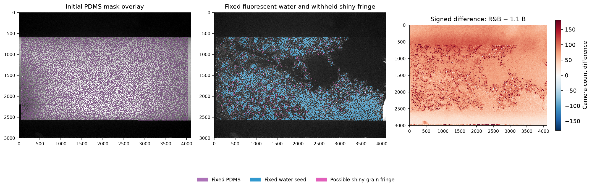
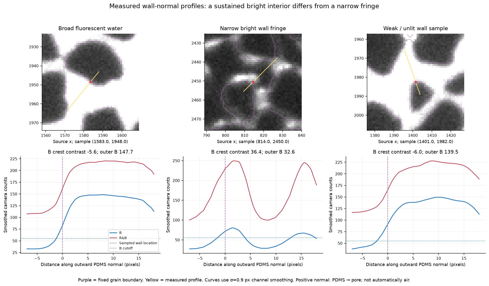
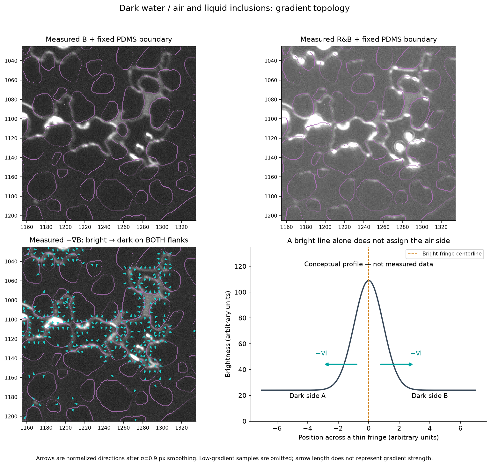
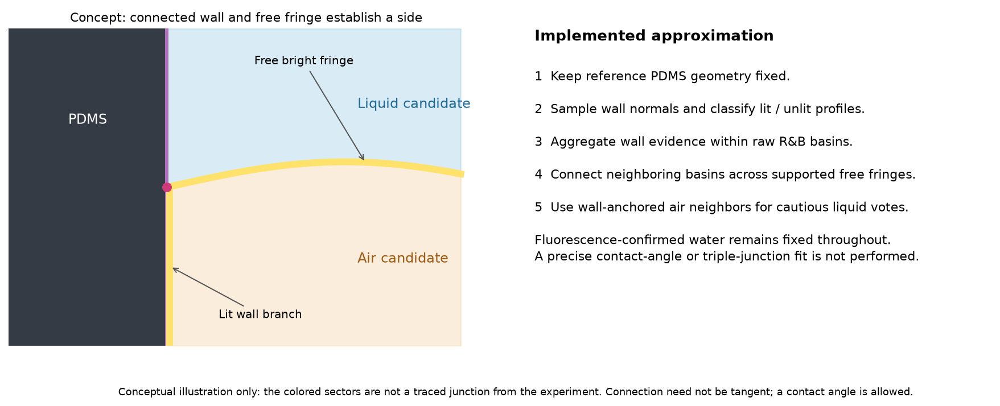
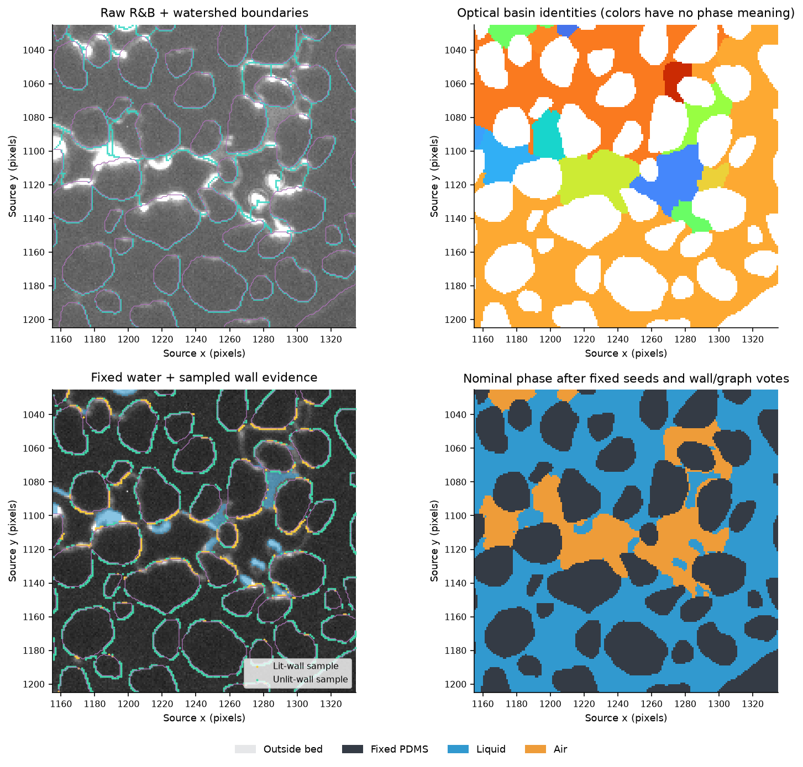
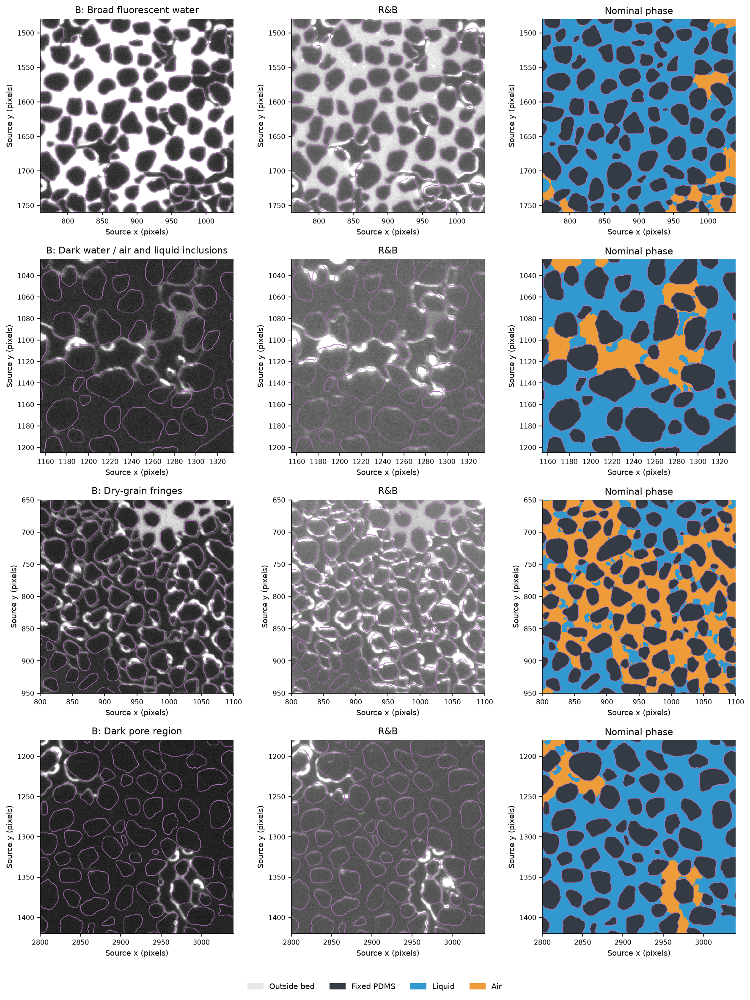
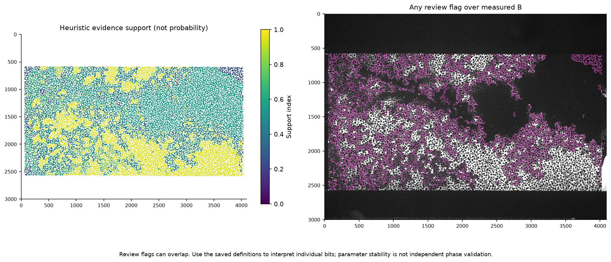
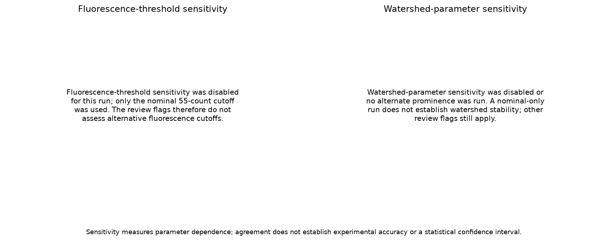

> Archived, sanitized example. [Archive details](ARCHIVED_EXAMPLE.md). Run the demo for a new resumable result.

# Fluorescence-first liquid–air analysis

Image: 4096 × 3000 pixels. Analysed pore pixels: 4,298,995. Nominal liquid: 67.17%; nominal air: 32.83%. Fixed fluorescence-water pixels: 35.33% of pores. Review-map unresolved/flagged pixels: 35.20% of pores. Nominal fractions include weak proposals and display fallbacks; use the review map with them.

Reference: initial camera image, stretched to its 2–99th percentiles.

## Purpose and what the map means

This workflow estimates liquid–air distribution in the initial pore space of the porous bed. Liquid includes both fluorescent water and dark diluted or fresh water. The initial PDMS grains are a separate fixed class. It uses the fixed grain reference, blue-only fluorescence and the red-plus-blue interface image together. It does not assume that darkness means air. The nominal map supplies a complete display partition; the review map retains unresolved or weakly supported areas. Both should accompany any reported phase fractions. These are optical proposals from two-dimensional images, without manual capsule outlines or phase training labels.



## 1. Read the pair and separate reference

This report describes one blue-only (B) and red-plus-blue (R&B) image pair on a common pixel grid. The fixed grain reference is prepared separately and reused for the series. Set the series limits and even/odd channel assignment manually in settings.py; the program does not infer illumination from index parity. Camera images are read without independent normalization, so thresholds stay on the original 0–255 camera-count scale. Different exposure, gain, illumination or bit depth requires revisiting these settings. B and R&B must describe the same scene with sufficiently little motion; automatic registration or deformation correction is not performed. The configured blue_shift_yx applies a manual translation to B. Every reference and pair must already have matching shape and field of view; masks are never resized to make them fit. Sources and settings are saved for reproducibility. The first panel is the separate initial camera image used for grain binarization.



## 2. Establish the bed and initial PDMS reference

The initial frame supplies grain geometry before the later phase interpretation. Uneven illumination is handled by a local Phansalkar threshold, using the configured window (nominally 101 pixels), rather than one global gray-level cutoff. For normalized initial intensity, the threshold is t=m[1+p exp(−qm)+k(s/r−1)], where m and s are the local mean and standard deviation. Nominal values are k=0.25, r=0.5, p=2 and q=10. Local statistics allow a dark grain to be separated from brighter pore space despite slow brightness variation. Small disconnected objects are removed and enclosed grain holes are filled. The bed mask restricts analysis to the experimental porous area. Pixels inside the bed are divided into PDMS and pores; grains are not expanded by a blanket dilation. This matters because real liquid films and menisci can be only a few pixels from a wall. Verify the purple overlay against the original frame, especially around small grains, dim edges and the bed perimeter. An incorrect initial mask propagates to every subsequent wall-normal and phase estimate. Distances and normals are pixel-based: there is no physical length calibration unless one is supplied separately. The binarization image may be stored separately from the B/R&B series. The reference is prepared once, then kept fixed across pairs. Optional initial_shift_yx translates this raw initial image before binarization. An optional external bed mask intersects the polygon/ROI restriction. Any separately supplied display reference is shown on the analysis grid without an additional shift.



## 3. Fix fluorescent water first

B is Gaussian-smoothed gently (nominal σ=0.9 pixels), then compared with the fluorescence cutoff (nominally 55 camera counts). Bright pore pixels become fixed liquid seeds before the interface-based classification. This is positive, one-sided evidence: the dye can fluoresce only in water, but absence of fluorescence does not exclude water. Every later hypothesis and watershed sensitivity run respects these fixed seeds. A bright pixel fixes that pixel, rather than automatically converting its entire optical basin to liquid. A basin with a substantial fluorescent interior can provide additional, explicitly weaker liquid evidence for its remaining pixels. The raw B and R&B images remain available for fringe and geometry measurements after the seeds are established; replacing them with a binary seed mask would discard useful structure.

## 4. Withhold narrow shiny grain fringes

Some dry-grain outlines are bright even in B. To avoid forcing all such outlines to liquid, the program samples brightness along outward normals to the initial PDMS boundary. The signed distance to the initial grain supplies a smoothed outward normal. Samples at offsets −4, −2, 0, 1, 2, 3, 4, 6 and 8 pixels measure grain-side baseline, near-wall crest and outer pore brightness. A valid profile needs grain-side and outer-pore samples and adequate clearance from the bed edge. Crest contrast is the near peak minus the larger of the grain and outer-pore baselines. A narrow B peak above a darker neighboring pore is treated differently from brightness sustained across a broad water-filled pore. The nominal exception uses wall proximity of 4.5 pixels, B crest contrast above 10 counts, and adjacent pore B below 45 counts, together with a valid wall profile. Only the corresponding near-wall pixels are withheld from fixed fluorescence labeling; they are not automatically classified as air. Broad fluorescent water remains liquid up to the wall. Purple boundaries, sampled lines, measured B/R&B curves and the actual selected profile coordinates are shown in the report. The initial edge and optical crest need not coincide exactly. Thin liquid films, overlapping fringes, unusual grain shapes and inaccurate normals can remain ambiguous, so inspect the exception overlay.



## 5. Prepare the subtraction without replacing raw evidence

The signed difference is D=R&B−αB, with α initially 1.1 and adjustable. It reduces blue-associated signal and helps identify red-associated fringe evidence, but is not a pure interface image. Changes in exposure, gain or blue intensity alter the required scale. Negative values are retained for analysis rather than silently clipped. Saturated R&B pixels cannot reveal their original crest height, and subtraction can create misleading dark basins in bright water. For that reason raw R&B defines the optical basins and raw B constrains liquid; difference contrast is supplementary. The configured image pair has no independent red-only exposure or calibrated spectral unmixing, so D should not be interpreted as a quantitative red-channel measurement.

## 6. Understand the two-sided gradient

For image intensity I, ∇I points from darker to brighter pixels; −∇I points from brighter to darker pixels. A thin bright water–air fringe surrounded by dark liquid on one side and dark air on the other produces gradients on both flanks. A gradient arrow therefore cannot independently identify the air side. The measured example shows −∇B after mild smoothing, with normalized arrow lengths and low gradients omitted. No arrow direction is forced toward a proposed air interior. The companion curve is explicitly a conceptual bright-line profile. The useful geometric object is the fringe centerline and its connection to the initial grain wall. A free fringe joining a lit air–PDMS wall branch can anchor the surrounding air sector, while the opposite sector is a liquid candidate. Such a join may have a contact angle; straightest continuation is not a sufficient criterion.



## 7. Infer remaining regions from wall and fringe topology

Smoothed raw R&B is partitioned by a marker-controlled watershed. H-minima suppress shallow minima; the nominal prominence is h=8 counts. Markers are kept away from the grain boundary where practical. Each resulting basin is an optical region, not automatically a pore or one physical phase. Valid PDMS-normal profiles are grouped by basin and counted as lit or unlit. Sufficient lit-wall coverage supports an air-side proposal, while broad fluorescence and suitable unlit-wall evidence support liquid. Neighboring basins are connected in a graph when their shared free boundary carries enough R&B and difference crest evidence. Cautious additional liquid votes can then come from the side opposite strongly wall-anchored air neighbors. This is an aggregate wall-side and region-adjacency approximation: it does not explicitly fit every fringe centerline, reconstruct every triple junction, or measure contact angles. Weak regions receive a nominal display label and remain flagged; completely unresolved regions display as liquid while retaining low support and review status. That fallback is not experimental confirmation of water. Watershed-parameter sensitivity was disabled or no alternate prominence was run. A nominal-only run does not establish watershed stability; other review flags still apply.



## 7a. Inspect the actual optical partition

The local diagnostic separates four things that are easy to confuse: measured R&B brightness, the optical watershed basins, sampled wall evidence, and the resulting nominal phase. Random-looking basin colors are identifiers and carry no liquid or air meaning. Cyan lines in the raw-image panel show actual watershed boundaries, which can follow a bright crest but can also split or merge a physical capsule. Yellow and green points indicate lit and unlit initial-wall samples. The blue fixed-water overlay is imposed before inference. A physical phase can span several basins, while one basin can contain both a fixed liquid pixel and an inferred air pixel. This is why the final mask is not simply one phase label per watershed region.



## 8. Keep possible liquid inclusions and inspect examples

Fixed fluorescent liquid is preserved even when surrounded by an air proposal, allowing holes within a capsule rather than a compulsory solid air blob. An additional conservative detector proposes compact bright liquid cores using local B and R&B prominence, separation from PDMS and an air-dominated surrounding ring. Those extra cores are flagged because an optical peak alone does not establish composition. This detector estimates bright cores, not complete droplet perimeters, and it may miss weak or dark inclusions. The example panels show raw B, raw R&B and nominal phase on the same source coordinates so residual water, free fringes and grain contacts can be compared. Apparent enclosure is only two-dimensional: the image cannot prove that a droplet is disconnected from liquid above, below or outside the focal plane.



## 9. Interpret uncertainty and sensitivity

Review status can arise from weak or conflicting wall evidence, parameter-dependent labels when the relevant sensitivity tests were run, clipping, a questionable grain fringe or inclusion-only evidence. Flag bits can overlap; consult the saved definitions. The support image is a heuristic evidence index, not a probability of correctness. The nominal phase map uses 0 outside, 1 PDMS, 2 liquid and 3 air; the review map can replace uncertain pore labels by 4. Compare both maps before using a global fraction. Fluorescence-threshold sensitivity was disabled for this run; only the nominal 55-count cutoff was used. The review flags therefore do not assess alternative fluorescence cutoffs. Watershed-parameter sensitivity was disabled or no alternate prominence was run. A nominal-only run does not establish watershed stability; other review flags still apply. Look for local changes around thin films and shiny edges as well as global fraction changes. Parameter agreement cannot detect a shared systematic error and does not prove that local interfaces are correct.



## 10. Run, tune and preserve the evidence

Select a Spyder environment containing requirements.txt, edit settings.py, then open RUN_ANALYSIS.py and press F5. Choose the separate reference mode, series index range and manual channel parity before processing new data. The fixed bed/pore geometry is reused across pairs, and each pair receives its own phase results and recorded saturation fractions. Inspect alignment, fixed grain boundaries, fluorescent-water seeds and withheld shiny fringes before adjusting phase inference. Change intensity cutoffs only in the original camera-count units, and enable additional parameter sensitivity runs when needed. Correct a bad grain mask at its source. Retain TIFF masks, signed differences, settings, pair and series summaries, source provenance and review flags together. Original inputs are read only, and report figure paths are relative so the result folder remains portable. These are reproducible exploratory estimates; manual review or independent phase references are needed for validation.



## Main settings and units

| Setting in settings.py | Units | Function |
| --- | --- | --- |
| `mask_input.mode` | binarize / load_binary | Create geometry from a separate camera image, or use an already binary grain mask exactly. |
| `mask_input.white_is_grain` | True / False | For external masks, choose whether nonzero or zero means PDMS. |
| `mask_input.bed_mask_path` | optional TIFF / PNG path | Nonzero pixels are inside the bed; intersected with the configured polygon/ROI. |
| `mask_input.display_reference_path` | optional TIFF / PNG path | Measured reference for figures; does not alter an external grain mask. |
| `grain.window` | pixels; odd integer | Local Phansalkar neighborhood; must span grain and neighboring pore structure. |
| `grain.sigma` | pixels | Smoothing before initial-grain thresholding. |
| `fluorescence.threshold` | camera counts | Positive B cutoff for fixed liquid pixels. |
| `fluorescence.sigma` | pixels | B smoothing used for the fluorescence cutoff. |
| `fluorescence.shiny_distance` | pixels | Near-wall range in which a valid narrow-fringe exception may apply. |
| `fluorescence.shiny_contrast` | camera counts | Minimum narrow B crest contrast for the shiny exception. |
| `fluorescence.outer_margin` | camera counts | Outer B must be below fluorescence cutoff minus this margin. |
| `blue_scale` | dimensionless | B multiplier in the signed R&B minus scaled-B difference. |
| `wall.normal_sigma` | pixels | Smoothing of the signed grain-distance field before normal estimation. |
| `wall.channel_sigma` | pixels | Channel smoothing before measured wall-profile features. |
| `wall.lit_rb` | camera counts | One criterion for a lit R&B wall crest; alternate combined criteria also exist. |
| `segmentation.watershed_h` | camera counts | Nominal h-minimum prominence; affects basin splitting and merging. |
| `segmentation.watershed_sensitivity` | camera counts | Additional watershed prominences to compare with the nominal labels. |
| `segmentation.air_wall_lit_fraction` | fraction of valid wall samples | One of several requirements for an accepted air-region proposal. |
| `segmentation.broad_water_region_fraction` | fraction of basin pixels | Minimum substantial direct-water coverage for extending a liquid-region hypothesis. |
| `fluorescence_sensitivity` | camera counts | Additional B cutoffs; each reruns fixed-water and phase assignment. |
| `gradient_sigma_px` | pixels | Smoothing for the illustrative measured gradient arrows. |


## Settings recorded for this run

```json
{
  "run_mode": "series",
  "input_folder": ".\\input_images",
  "output_folder": ".\\example_batch_results",
  "mask_input": {
    "mode": "binarize",
    "image_path": ".\\input_images\\Basler_acA4112-20um__40402042__20261023_163522172_0001.tiff",
    "grain_mask_path": null,
    "white_is_grain": true,
    "bed_mask_path": null,
    "display_reference_path": null
  },
  "series": {
    "start_index": 6544,
    "end_index": 6545,
    "blue_parity": "odd",
    "file_pattern": null,
    "index_regex": "(?P<index>\\d+)$",
    "unpaired_policy": "error",
    "missing_pair_policy": "error",
    "pair_interval_seconds": null
  },
  "batch": {
    "report_policy": "first",
    "sensitivity_policy": "none",
    "export_level": "minimal",
    "pair_error_policy": "stop",
    "plot_every": 10,
    "preflight_shapes": true,
    "resume_from": null,
    "retain_last_pair": true
  },
  "red_blue_image": "6544",
  "blue_image": "6545",
  "expected_shape_hw": [
    3000,
    4096
  ],
  "show_figures": false,
  "make_report": true,
  "save_intermediate_arrays": false,
  "hash_pair_sources": true,
  "bed_polygon_xy": [
    [
      55,
      576
    ],
    [
      4030,
      590
    ],
    [
      4030,
      2580
    ],
    [
      55,
      2570
    ]
  ],
  "roi_xyxy": null,
  "blue_scale": 1.1,
  "initial_shift_yx": [
    0.0,
    0.0
  ],
  "blue_shift_yx": [
    0.0,
    0.0
  ],
  "grain": {
    "window": 101,
    "k": 0.25,
    "r": 0.5,
    "p": 2.0,
    "q": 10.0,
    "sigma": 0.8,
    "min_area": 25,
    "intensity_scale": 255.0
  },
  "wall": {
    "normal_sigma": 1.1,
    "channel_sigma": 0.9,
    "bed_clearance": 10.0,
    "profile_chunk_size": 200000,
    "lit_rb": 14.0,
    "lit_d": 12.0,
    "lit_d_min_rb": 6.0,
    "lit_b": 10.0,
    "lit_b_min_rb": 5.0,
    "unlit_rb": 6.0,
    "unlit_b": 5.0,
    "unlit_d": 6.0
  },
  "fluorescence": {
    "threshold": 55.0,
    "sigma": 0.9,
    "shiny_distance": 4.5,
    "shiny_contrast": 10.0,
    "outer_margin": 10.0
  },
  "segmentation": {
    "watershed_sigma_px": 1.0,
    "watershed_h": 8.0,
    "watershed_sensitivity": false,
    "air_wall_lit_fraction": 0.27,
    "air_wall_min_lit_samples": 12,
    "air_wall_min_valid_samples": 20,
    "air_wall_max_unlit_fraction": 0.65,
    "broad_water_region_fraction": 0.6,
    "broad_water_min_pixels": 20,
    "use_fringe_graph": true,
    "detect_liquid_inclusions": true
  },
  "fluorescence_sensitivity": [],
  "review_boundary_width_px": 2,
  "gradient_sigma_px": 0.9,
  "examples": [
    {
      "name": "Broad fluorescent water",
      "xyxy": [
        760,
        1480,
        1040,
        1760
      ]
    },
    {
      "name": "Dark water / air and liquid inclusions",
      "xyxy": [
        1155,
        1025,
        1335,
        1205
      ]
    },
    {
      "name": "Dry-grain fringes",
      "xyxy": [
        800,
        650,
        1100,
        950
      ]
    },
    {
      "name": "Dark pore region",
      "xyxy": [
        2800,
        1180,
        3040,
        1420
      ]
    }
  ],
  "export_level": "minimal"
}
```

## Summary recorded for this run

```json
{
  "shape_hw": [
    3000,
    4096
  ],
  "pore_pixels": 4298995,
  "liquid_fraction_of_pore": 0.6717088528830576,
  "air_fraction_of_pore": 0.32829114711694246,
  "review_fraction_of_pore": 0.35196040004698775,
  "direct_fluorescence_water_pixels": 1518903,
  "shiny_exception_pixels": 169761,
  "blue_scale": 1.1,
  "fluorescence_cutoff_counts": 55.0,
  "fluorescence_sensitivity": [],
  "watershed_sensitivity": [
    {
      "watershed_h": 8.0,
      "regions": 3405,
      "nominal_liquid_fraction_of_pore": 0.6717088528830576,
      "nominal_air_fraction_of_pore": 0.32829114711694246,
      "weak_fraction_of_pore": 0.2689256442494118,
      "automatic_inclusion_core_count": 28,
      "automatic_inclusion_core_pixels": 1821
    }
  ],
  "grain_geometry": {
    "method": "polygon",
    "bed_polygon_xy": [
      [
        55.0,
        576.0
      ],
      [
        4030.0,
        590.0
      ],
      [
        4030.0,
        2580.0
      ],
      [
        55.0,
        2570.0
      ]
    ],
    "grain_method": "Phansalkar",
    "window": 101,
    "k": 0.25,
    "r": 0.5,
    "p": 2.0,
    "q": 10.0,
    "sigma": 0.8,
    "min_area": 25,
    "intensity_scale": 255.0,
    "grain_dilation_px": 0,
    "bed_pixels": 7918204,
    "grain_pixels": 3619209,
    "pore_pixels": 4298995,
    "warnings": [],
    "initial_shift_yx": [
      0.0,
      0.0
    ],
    "binarization_performed": true,
    "binary_input_levels": null,
    "mask_input_mode": "binarize",
    "reference_kind": "raw_initial",
    "shape_hw": [
      3000,
      4096
    ],
    "grain_pixels_excluded_outside_bed": 0,
    "external_masks_resized_or_cleaned": false
  },
  "checks": {
    "fixed_water_preserved": true,
    "grains_preserved": true,
    "outside_bed_excluded": true,
    "pore_partition_complete": true,
    "no_fluorescence_on_grain": true
  },
  "reference_kind": "raw_initial",
  "saturation": {
    "pore_pixel_count": 4298995,
    "liquid_pixel_count": 2887673,
    "air_pixel_count": 1411322,
    "liquid_saturation": 0.6717088528830576,
    "air_saturation": 0.32829114711694246,
    "nominal_liquid_fraction_of_pore": 0.6717088528830576,
    "nominal_air_fraction_of_pore": 0.32829114711694246,
    "reviewed_pore_pixels": 1513076,
    "unreviewed_pore_pixels": 2785919,
    "unreviewed_liquid_pixels": 2446523,
    "unreviewed_air_pixels": 339396,
    "review_fraction": 0.35196040004698775,
    "liquid_saturation_unreviewed": 0.878174491074579,
    "air_saturation_unreviewed": 0.12182550892542102,
    "liquid_saturation_lower_possible": 0.5690918458849104,
    "liquid_saturation_upper_possible": 0.921052245931898,
    "air_saturation_lower_possible": 0.07894775406810196,
    "air_saturation_upper_possible": 0.4309081541150897,
    "blue_clipped_pore_pixels": 19777,
    "blue_clipped_fraction": 0.00460037753009715,
    "RB_clipped_pore_pixels": 393718,
    "RB_clipped_fraction": 0.09158373061610911
  },
  "runtime_versions": {
    "python": "3.12.14",
    "numpy": "2.5.4",
    "scipy": "1.18.1",
    "scikit_image": "0.26.0",
    "tifffile": "2026.10.15"
  },
  "interpretation": "Projected pore-pixel estimates; no physical volume or accuracy calibration.",
  "annotations_used_as_seeds": false,
  "water_identified_before_remaining_phase_inference": true,
  "stage_order": [
    "initial geometry",
    "signed subtraction and wall profiles",
    "fixed positive-fluorescence water",
    "remaining phase inference",
    "sensitivity and review",
    "exports and illustrated guide"
  ]
}
```
